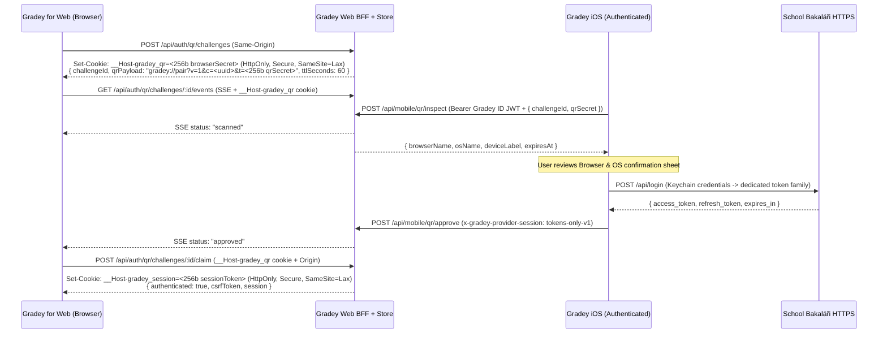

# Gradey for Web — Architecture, Security & Deployment

Gradey for Web extends the Gradey 2 ecosystem with a desktop-first web client (`web/`) authenticated exclusively via QR-based device linking from Gradey on iPhone (`Settings → Linked Devices → Link a Device`).

---

## 1. Architectural Overview & Bakaláři Token Isolation

### Why a Same-Origin Backend-for-Frontend (BFF) Is Required

1. **Bakaláři single-use rotating refresh tokens (`POST /api/login`)**:
   - Bakaláři OAuth2 (`client_id=ANDR`) rotates `refresh_token` on every redemption and immediately invalidates the previous refresh token (`400 Bad Request: token already redeemed`).
   - Sharing a refresh token between the iPhone, the Supabase background mark poller, or multiple web browsers would break sessions as soon as two clients refresh.
   - **Solution**: When the user approves a web browser on their iPhone (`GradeyLinkedWebDeviceClient.makeDedicatedWebSessionPayload`), the iPhone performs a **separate direct HTTPS sign-in to the school server** using its device-only Keychain credentials (`kSecAttrAccessibleAfterFirstUnlockThisDeviceOnly`). It verifies `newRefreshToken != phoneRefreshToken` and uploads **only** that dedicated web token family (`accessToken`, `refreshToken`, `expiresAt`, `webSessionEstablishedAt`).
   - Raw school passwords never leave the iPhone, never appear in QR codes, and are rejected at both the HTTP boundary (`containsProviderPassword`) and the database encryption allowlist (`sanitize_provider_secret`).
   - Once paired, the web session refreshes its own Bakaláři token family independently on the server using a per-session single-flight mutex (`SchoolProviderProxy.refreshLocks`), **so the phone does not need to stay online**.
   - **Architectural limitation**: If the school server eventually revokes or expires the web session's refresh token (for example, after a school password change or extended inactivity), the backend cannot re-authenticate with a password because passwords are never stored. The web client transitions cleanly back to the QR login screen with a prompt to link again.

2. **First-party `HttpOnly; Secure; SameSite=Lax` cookies & school CORS**:
   - Individual Czech schools self-host Bakaláři on IIS servers that do not emit CORS headers for third-party web origins and reject `Accept-Language: *` with HTTP 500.
   - Browser JavaScript never holds Bakaláři tokens, Supabase tokens, or credentials in `localStorage` or `sessionStorage`.
   - The Gradey for Web BFF serves both the static SPA (`dist/client`) and `/api/*` from the **same origin**, authenticating the browser exclusively with an opaque 256-bit `__Host-gradey_session` cookie (`HttpOnly; Secure; SameSite=Lax; Path=/`).

---

## 2. Cryptographic QR Pairing Flow



### Security Properties

- **Zero sensitive data in QR codes**: QR payload is strictly `gradey://pair?v=1&c=<uuid>&t=<base64url-256b>`.
- **Browser binding (QRLJacking defense)**: Inspecting status, opening the SSE stream, and claiming an approved challenge all require constant-time SHA-256 verification of the requesting browser's `HttpOnly` `__Host-gradey_qr` cookie. Another browser cannot claim a challenge even if it knows `challengeId`.
- **60-second TTL & automatic regeneration**: Challenges expire strictly after 60 seconds and regenerate automatically on screen without a page reload.
- **Single-use & replay defense**: Redeeming a claimed challenge a second time fails (`409 Conflict`) and immediately revokes the associated web session (`challenge_replay_detected`).
- **Brute-force protection**: Sliding-window rate limiters guard challenge creation, claiming, and mobile scanning; 5 failed `qrSecret` checks permanently invalidate a challenge.
- **Encryption at rest**: Provider tokens are encrypted using AES-256-GCM (`SqliteWebDeviceStore`) or PostgreSQL `pgcrypto` AES-256 (`SupabaseWebDeviceStore` via `store_provider_secret` / `update_provider_secret`). Only SHA-256 hashes of `qrSecret`, `browserSecret`, and `sessionToken` are persisted.
- **Session rotation & theft detection**: Active web session cookies rotate every 15 minutes with a 30-second overlap grace window for concurrent tab requests. Reusing a rotated-out cookie after the grace window revokes the session immediately.
- **CSRF & hijacking protection**: State-changing browser endpoints enforce `SameSite=Lax`, `Origin` / `Sec-Fetch-Site` validation, and HMAC-SHA256 `X-CSRF-Token` verification. OS family mismatches across requests are rejected.
- **Instant remote revocation**: Revoking one or all web sessions in `Settings → Linked Devices` deletes the encrypted provider secret, marks `revoked_at`, and pushes a `revoked` SSE event to sign out open browser tabs immediately.

---

## 3. Repository Structure

| Path | Responsibility |
| --- | --- |
| `web/src/shared/` | Shared TypeScript domain models, `GradeMath`, `AbsenceRisk`, `TimetableMapper`, and EN/CS localization catalog |
| `web/src/server/` | Hono BFF HTTP server, QR pairing state machine, AES-256-GCM / Supabase stores, security primitives, and Bakaláři/EduPage proxy |
| `web/src/client/` | React 19 desktop-first SPA (`QRLoginScreen`, `Today`, `Marks`, `Timetable`, `Absence`, `Homework`, `Settings`) |
| `web/tests/` | Vitest security suite, session rotation/revocation tests, and end-to-end pairing + Bakaláři proxy tests |
| `supabase/migrations/20261125183000_gradey_web_device_linking.sql` | PostgreSQL `web_sessions` & `web_pairing_challenges` tables, RLS, secret cleanup trigger, and atomic revocation RPCs |
| `supabase/functions/web-linked-devices/` | Supabase Edge Function endpoint for mobile device management & QR approval |
| `Gradely/Platform/LinkedWebDeviceService.swift` | Mobile QR parser, dedicated Bakaláři session minting, API client, and `LinkedDevicesViewModel` |
| `Gradely/Views/LinkedDevicesView.swift` | Mobile `Settings → Linked Devices` screen, AVFoundation QR scanner, and pairing confirmation sheet |

---

## 4. Environment Variables

### Web Server (`web/.env` or container environment)

| Variable | Required | Description |
| --- | --- | --- |
| `WEB_BFF_GATEWAY_SECRET` | **Recommended** | Shared random secret (`>= 32` chars) authenticating the web BFF to the `web-bff-gateway` Supabase Edge Function so `PROVIDER_SECRET_KEY` and `SUPABASE_SERVICE_ROLE_KEY` never leave Supabase. |
| `GRADEY_WEB_CSRF_SECRET` | Optional | Separate random secret (`>= 32` chars) for HMAC CSRF derivation; defaults to `WEB_BFF_GATEWAY_SECRET` or `PROVIDER_SECRET_KEY`. |
| `SUPABASE_URL` | **Yes** (prod) | Hosted Gradey Supabase URL (`https://<project-ref>.supabase.co`). |
| `SUPABASE_ANON_KEY` | **Yes** (prod) | Client-safe Supabase publishable/anon key. |
| `PROVIDER_SECRET_KEY` | Optional | Only required for direct `SupabaseWebDeviceStore` or standalone `SqliteWebDeviceStore` modes when `WEB_BFF_GATEWAY_SECRET` is not used. |
| `SUPABASE_SERVICE_ROLE_KEY` | Optional | Enables direct `SupabaseWebDeviceStore` when `WEB_BFF_GATEWAY_SECRET` is omitted. |
| `GRADEY_WEB_ALLOWED_ORIGINS` | Recommended | Comma-separated allowed browser origins (for example, `https://web.gradey.app`). |
| `PORT` | Optional | HTTP listening port (defaults to `8787`). |

### iOS / macOS App (`Config/Secrets.xcconfig`)

| Setting | Required | Description |
| --- | --- | --- |
| `GRADEY_WEB_URL` | Optional | Base HTTPS URL of the deployed Gradey for Web BFF (`https:/$()/web.gradey.app`). When omitted, mobile falls back to `$(SUPABASE_URL)/functions/v1/web-linked-devices` sharing the same PostgreSQL tables. |

---

## 5. Local Development & Deployment

### Local Development

```sh
cd web
cp .env.example .env
# Populate SUPABASE_URL, SUPABASE_ANON_KEY, and PROVIDER_SECRET_KEY in .env
npm install

# Terminal 1: start the BFF API server on :8787
npm run dev

# Terminal 2: start Vite dev server on http://localhost:5173 (proxies /api -> :8787)
npm run dev:client
```

### Running Tests

```sh
# Web security, revocation, and E2E pairing tests
cd web && npm test

# Supabase shared sanitizer & Edge Function checks
deno test supabase/functions/_shared/
deno check supabase/functions/web-linked-devices/index.ts
```

### Production Deployment

1. **Apply database migration & deploy Edge Functions**:
   ```sh
   supabase db push
   supabase secrets set WEB_BFF_GATEWAY_SECRET="$(openssl rand -base64 36)"
   supabase functions deploy web-linked-devices
   supabase functions deploy web-bff-gateway --no-verify-jwt
   supabase functions deploy request-data-export
   ```
2. **Build and run Gradey for Web** (Node 22+ on Fly.io, Cloud Run, Railway, or Docker behind TLS):
   ```sh
   cd web
   npm ci
   npm run build
   NODE_ENV=production npm start
   ```
   The Node server serves both `/api/*` and the compiled SPA (`dist/client`) from one HTTPS origin so `__Host-gradey_qr` and `__Host-gradey_session` cookies operate as strict first-party `HttpOnly; Secure; SameSite=Lax` cookies across Safari, Chrome, and Firefox.
3. **Configure mobile build** (`Config/Secrets.xcconfig`):
   Set `GRADEY_WEB_URL = https:/$()/web.gradey.app` so mobile QR scans notify the BFF SSE stream directly with sub-100ms latency.
